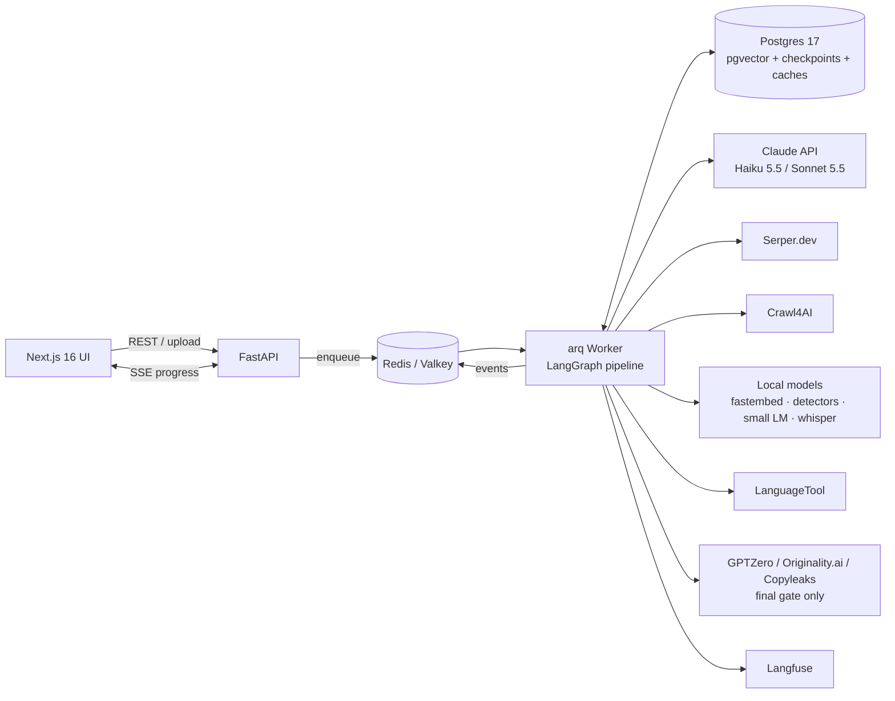
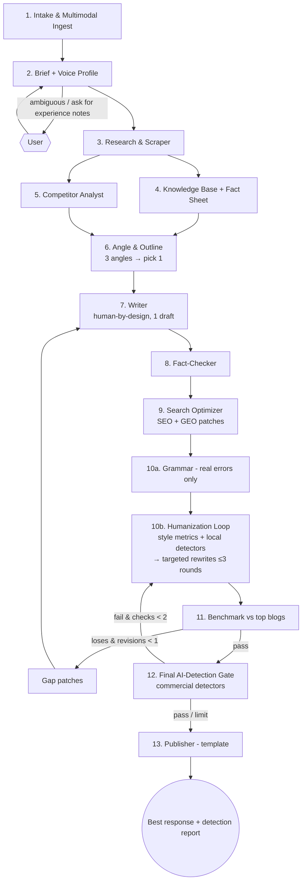

# Plan: Multimodal Multi-Agent Content Writing System

**Version:** 2, cost-optimised and humanization-first
**Status:** Draft, awaiting approval
**Complexity:** High
**Date:** 2026-10-22

**What changed since v1:**
- **Cost:** about 70–80% lower per article. Cheaper models handle routine steps, plain code replaces AI calls where possible, editors change only flagged sentences, and the system writes 1 draft instead of 3.
- **Humanization:** a new humanization pipeline (§6) makes the output read as genuinely human-written and checks it against several AI-detection tools before delivery.

---

## 1. Summary

The user gives a topic as a prompt, and can attach files, images, audio or URLs. A group of specialised agents then:

1. Improves the prompt.
2. Researches the live web.
3. Builds a knowledge base from the research.
4. Writes the article in a human voice from the start.
5. Fact-checks it and optimises it for SEO and GEO (ranking in AI answer engines).
6. Runs it through a **humanization loop**: deterministic writing-style analysis, plus free local AI detectors, plus targeted sentence rewrites.
7. Benchmarks it against the top-ranking blogs for the same query.
8. Puts it through a final **AI-detection gate** that uses commercial detectors.

The user receives only the best article. Two goals drive this version: **minimum cost per article** and **maximum human-likeness**.

## 2. Requirements

### Functional

| # | Requirement |
|---|---|
| F1 | Accept a topic as free text, plus optional attachments: PDF, DOCX, images, audio, YouTube or web URLs. |
| F2 | A **Prompt Refiner** agent turns the request into a structured *Content Brief* and a *Voice Profile* (how the article should sound). |
| F3 | A **Research** agent searches and scrapes the internet for fresh, credible sources. |
| F4 | A **Knowledge Base** agent indexes the sources and extracts a fact sheet in which every fact has a source. |
| F5 | A **Writer** produces a draft that is human in style from the start, and every claim cites a source. |
| F6 | **Fact-check**, **SEO + GEO**, **grammar** and **humanize** agents improve the draft. |
| F7 | **Humanization (priority):** the final article must pass a configurable panel of AI detectors (e.g. GPTZero, Originality.ai, Copyleaks) at the thresholds set in config. Deterministic style metrics must also be within their target ranges. |
| F8 | A **Benchmark** agent compares the article with the top-ranking blogs and sends a list of gaps back to the writer if the article loses. |
| F9 | The user receives **only the best response**: the article, meta data, structured-data markup (JSON-LD), sources, a scorecard and an AI-detection report. |
| F10 | The user can optionally add *personal experience notes* (anecdotes, opinions, their own data) and *writing samples*. These are the strongest human signals, so the UI asks for them. |
| F11 | Live progress, in-browser editing with the remaining "AI-sounding" sentences highlighted, and export (Markdown, HTML, DOCX). |

### Non-functional

- **Cost:** median cost per 2,000-word article ≤ **$1.25**, all-in (AI models, detectors, search API). Each job has a hard budget cap, and every run's cost is recorded.
- **Grounded:** every factual claim traces back to a source in the knowledge base, and humanization must not change facts.
- **Original:** low overlap with the scraped sources.
- **Observable and resumable:** every run is traced and checkpointed after each step.
- **Safe:** scraped text is treated as data, never as instructions, and user-supplied URLs get SSRF protection.

### Patterns to mirror

There are none. This is a new codebase, so the conventions are defined in Step 1.

---

## 3. Tech Stack

| Layer | Choice | Why |
|---|---|---|
| **LLM: reasoning and writing tier** | **Claude Sonnet 5.5** (`claude-sonnet-5-5`, $2 in / $10 out per million tokens) | Strong writer and editor at half the Opus price. Used for outline, writing, fact verification, humanize rewrites and judging. |
| **LLM: bulk tier** | **Claude Haiku 5.5** (`claude-haiku-5-5`, $0.10 / $0.50 per million tokens up to 100K-token prompts) | 20 times cheaper than Sonnet. Used for extraction, classification, claim splitting, metadata and parsing. |
| LLM: premium (optional) | Claude Opus 5.5 (`claude-opus-5-5`) | Only when the user picks a "Premium quality" toggle. Off by default. |
| LLM SDK | Official `anthropic` Python SDK | Structured outputs, citations, prompt caching, Batch API, streaming. |
| **Orchestration** | **LangGraph 1.x** (Python), nodes call the Anthropic SDK directly | Fixed graph with loops, checkpoints and pause-for-user-input. |
| **Backend** | **Python 3.13, FastAPI, Pydantic v2**, **uv** | Async and typed; the Pydantic models double as the LLM output schemas. |
| Jobs and live progress | **arq** on **Redis / Valkey 8**, **SSE** | Long-running jobs with a live progress stream. |
| **Search results** | **Serper.dev** (cheap Google search results) by default; **DataForSEO** optional for keyword volumes | Cheapest way to get the real top-10 results. Claude's web search tool is not used, which removes its per-search fee and token cost. |
| **Scraping** | **Crawl4AI** (Playwright) with **trafilatura** as fallback, plus content-hash caching | Free, open source, outputs Markdown, keeps the heading structure. |
| Multimodal ingest | Claude Haiku vision for images and PDFs, **faster-whisper** (local) for audio, **youtube-transcript-api**, **docling** | Mostly free local tools; the cheapest model only for images. |
| **Knowledge base** | **PostgreSQL 17 + pgvector**, hybrid search (vector plus full-text) | One database for app data, vectors and checkpoints. |
| **Embeddings and rerank** | **fastembed** (local ONNX models, e.g. `bge-small-en-v1.5` and `bge-reranker-base`) | No per-call API cost and fast on CPU. Voyage AI is an optional upgrade. |
| **Writing-style analysis** | **spaCy**, **textstat**, **lexicalrichness**, plus a local small language model (via `llama-cpp-python` or `transformers`) to measure how predictable the text is | Free, deterministic measurements of how human the writing pattern is (see §6). |
| **Local AI detectors** (free, run on every loop) | Open-source AI-text classifiers from Hugging Face run on CPU (a RoBERTa/DeBERTa-class detector), plus a predictability and variation scorer; optionally **Binoculars** if a GPU is available | Score each sentence for free, so only the flagged parts get rewritten. |
| **Commercial AI detectors** (final gate only) | **GPTZero API**, **Originality.ai API** (also checks plagiarism), **Copyleaks AI Detector API**; you choose which to enable | The real tools readers and clients check with. Run once or twice per article to control cost. |
| Grammar | **LanguageTool** (self-hosted, free), limited to real errors | Fixes errors without polishing away the natural voice; over-polished text reads as AI. |
| SEO and GEO checks | Custom Python scorers, **extruct** for schema validation | Deterministic and free. |
| **Frontend** | **Next.js 16, React 19, TypeScript, Tailwind CSS v4, shadcn/ui, TipTap** | Modern and easy to use; TipTap shows highlighted "AI-sounding" sentences for editing. |
| Auth | **Better Auth** (self-hosted, free) | No per-user fees. |
| Observability | **Langfuse** (self-hosted) | Cost and trace per agent, eval datasets. |
| Testing | pytest, pytest-asyncio, respx, Vitest, Playwright | Unit, integration and end-to-end. |
| **Deployment (low cost)** | **Single VPS with Docker Compose** (e.g. a Hetzner machine with 8 vCPU and 16 GB: API, worker, Postgres, Redis, LanguageTool, Langfuse, local models), frontend on Vercel's free tier | About $15–30 per month in total, instead of several managed services. |
| CI | GitHub Actions: ruff, mypy, pytest, eslint, `tsc`, vitest | Quality gates on every pull request. |

---

## 4. Cost Optimisation Strategy

### 4.1 Levers, in order of impact

| # | Lever | What changes | Estimated saving |
|---|---|---|---|
| 1 | **Model tiering** | Haiku 5.5 for bulk work, Sonnet 5.5 for writing and judgement; Opus only as a premium option. | ~50–60% |
| 2 | **One draft instead of three** | Generate 3 cheap *angle and outline* options (short JSON), pick one, then write **one** full draft. | ~25% of writing cost |
| 3 | **Patch-based edits** | Editors (SEO, GEO, humanizer, fact-fix) return JSON *patches* for specific sentences instead of rewriting the whole article. Output tokens cost 5 times as much as input tokens, so this is the biggest saving in the editing stage. | ~60–80% of editing cost |
| 4 | **Plain code instead of AI calls** | SEO scoring, readability, originality, writing-style metrics, the AI-phrase checker, competitor heading parsing, de-duplication and grammar are all plain code or free local tools. | Removes ~5 AI calls |
| 5 | **Merged agents** | SEO and GEO become one "Search Optimizer"; Rephrase merges into the Humanizer; the Draft Judge disappears (lever 2); the Publisher is a template. | Fewer calls and repeated context |
| 6 | **Smaller AI inputs** | Sources are condensed into a fact sheet once (by Haiku). Later agents get the fact sheet, outline and top-k retrieved chunks, never raw pages. Haiku prompts stay under 100K tokens to keep its lowest price tier. | ~40% of input tokens |
| 7 | **Prompt caching** | System prompts, tool lists and voice profile stay byte-identical and come first, so the humanize loop and revisions reuse the cache (cache reads cost 10% of normal input). | ~20–30% of input cost |
| 8 | **Lower reasoning effort and no extended thinking on simple steps** | Haiku runs with thinking disabled for extraction; Sonnet uses `effort: low/medium` and runs without extended thinking on simple editing passes. | ~20% |
| 9 | **Result caching across jobs** | Search results cached per query and locale for 24 hours; scraped pages cached by URL and content hash for 7 days; embeddings cached by content hash. Similar topics reuse the research. | Varies; large for niche sites |
| 10 | **Detector cost control** | Free local detectors on every loop; commercial detectors **only on the final article**, at most 2 checks. | ~80% of detector spend |
| 11 | **Shorter loops** | Benchmark revision at most once (was twice); humanize loop at most 3 local rounds. | Caps the worst case |
| 12 | **Batch API (bulk mode)** | Non-urgent or scheduled jobs use the Message Batches API at 50% off. | 50% on bulk jobs |
| 13 | **Infrastructure** | Single VPS, local embeddings, local speech-to-text, self-hosted auth and observability. | Fixed ~$15–30 a month |

### 4.2 Model and effort per agent

| Agent | Model | Effort / thinking |
|---|---|---|
| Intake (images only) | Haiku 5.5 | thinking off |
| Brief and voice profile | Haiku 5.5 | `low` |
| Research query planner | Haiku 5.5 | `low` |
| Fact-sheet extraction | Haiku 5.5 | thinking off |
| Competitor summary | Haiku 5.5 | thinking off |
| Angle and outline | Sonnet 5.5 | `medium` |
| Writer | Sonnet 5.5 | `medium` |
| Fact-check: split claims / verify / escalate | Haiku splits the article into claims; Haiku verifies with citations; Sonnet handles only the unclear claims | thinking off / `low` |
| Search Optimizer (SEO + GEO) | Sonnet 5.5 | `low`, patches only |
| Humanizer rewrites | Sonnet 5.5 | `medium`, patches only |
| Benchmark judge | Sonnet 5.5 | `low` (deterministic metrics carry most of the score) |

### 4.3 Estimated cost per 2,000-word article

These are estimates to be checked with real data in Step 12.

| Item | v1 (all Opus 5.5) | v2 |
|---|---|---|
| AI model calls | ~$2.00–5.00 | **~$0.35–0.75** |
| Search API | ~$0.01 | ~$0.002 |
| Embeddings | ~$0.01 | $0 (local) |
| Commercial AI detectors (final gate, 1–2 checks) | — | ~$0.15–0.45 |
| **Total** | **~$2–5** | **~$0.50–1.20** |

---

## 5. Architecture

### 5.1 System overview



### 5.2 Agent pipeline



**Main design choices:**

- **Humanize after SEO and GEO.** Optimisation edits tend to bring AI patterns back, so humanization runs last. To keep the SEO gains, the humanizer gets a list of **protected spans** it must not change: keywords, citations, numbers, quotes and headings. The SEO check runs again after humanizing.
- **Grammar before humanizing, real errors only.** LanguageTool fixes spelling and agreement errors. Style rules are switched off, because over-polished text reads as AI.
- **Fact preservation.** After each humanize round, a deterministic comparison checks that every number, named entity and citation is unchanged. A patch that alters a fact is rejected.
- **Bounded loops** keep the cost predictable: humanize at most 3 local rounds, benchmark revision at most 1, commercial detector checks at most 2.

### 5.3 Pipeline state (core schema)

```python
class VoiceProfile(BaseModel):
    persona: str                       # e.g. "practitioner with 10 yrs in X"
    pov: Literal["first_person", "second_person", "third_person"]
    formality: Literal["casual", "conversational", "professional"]
    sample_excerpts: list[str]         # from user writing samples / accepted edits
    signature_phrases: list[str]
    avoid_phrases: list[str]           # user-specific + global AI-ism lexicon
    experience_notes: list[str]        # user anecdotes, opinions, own data

class StyleMetrics(BaseModel):
    sentence_len_mean: float
    sentence_len_stdev: float          # burstiness
    mtld: float                        # lexical diversity
    perplexity: float                  # under local small LM
    ai_phrase_hits: int
    em_dash_per_1k: float
    transition_density: float
    repeated_openers: int
    paragraph_len_stdev: float

class DetectorResult(BaseModel):
    detector: str                      # "local_roberta", "gptzero", "originality", ...
    ai_probability: float              # 0–1
    flagged_spans: list[Span]          # sentence/paragraph offsets with scores

class Patch(BaseModel):
    span: Span
    original: str
    replacement: str
    reason: str

class PipelineState(BaseModel):
    job_id: str
    raw_prompt: str
    attachments: list[Attachment]
    brief: ContentBrief | None = None
    voice: VoiceProfile | None = None
    sources: list[Source] = []
    fact_sheet: list[Fact] = []
    serp_blueprint: SerpBlueprint | None = None
    outline: Outline | None = None
    article: Draft | None = None
    protected_spans: list[Span] = []
    style_metrics: StyleMetrics | None = None
    detector_results: list[DetectorResult] = []
    reports: dict[str, AgentReport] = {}
    benchmark: Scorecard | None = None
    humanize_round: int = 0
    paid_detector_checks: int = 0
    revision: int = 0
    cost_usd: float = 0.0              # running total, enforced against budget
    final: FinalArticle | None = None
```

---

## 6. Humanization Strategy (the priority)

The goal is writing that **is** more human: specific, opinionated, varied and lived-in. It is not to trick detectors with tricks that hurt the text. Detectors respond to the same signals readers do, so improving the writing is also what moves the scores reliably.

### Layer A: human by design (at writing time)

- **Voice Profile:** built from the user's writing samples, or from a chosen persona preset. It includes sentence-rhythm examples, point of view, formality, signature phrases and phrases to avoid. It goes into the Writer's cached system prompt.
- **Experience notes:** the UI asks the user for 2–3 personal anecdotes, opinions or their own data points. The Writer weaves them in. This is the single strongest human signal, and it also helps rankings, because Google values first-hand experience (E-E-A-T: experience, expertise, authoritativeness, trust).
- **Writer rules:**
  - Specific beats general: name tools, numbers, places and mistakes.
  - Take a stance, and allow mild hedging or disagreement.
  - Mix very short sentences with longer ones.
  - Use contractions.
  - Use rhetorical questions sparingly.
  - Give sections different shapes: not every section ends with a list, and not everything comes in threes.
  - No "In conclusion" summary paragraphs.
  - Each paragraph does one job.
- **AI-phrase lexicon:** a maintained list of phrases that mark text as AI-written, such as "delve", "in today's fast-paced world", "tapestry", "it's important to note", "navigating the landscape", "unlock the power", "not just X but Y", "in conclusion", heavy em-dash use and stacked adjectives. It sits in the prompt *and* is enforced by a free regex checker.
- **No temperature tuning:** sampling settings like temperature can't be changed on Sonnet 5.5 or Haiku 5.5, so variety comes from the voice profile, the examples and the angle choice.

### Layer B: deterministic writing-style analysis (free, every round)

| Metric | Why it matters | Target (tuned on a set of real human blog posts in Step 8) |
|---|---|---|
| Sentence-length spread (burstiness) | AI text has unusually even rhythm | Std dev ≥ ~8 words |
| Paragraph-length spread | Uniform blocks look generated | Std dev ≥ ~25 words |
| Lexical diversity (MTLD) | AI repeats a safe vocabulary | ≥ the human baseline |
| Predictability under a local small language model | AI text is unusually predictable | Within the human range |
| AI-phrase hits | Obvious tells | **0** |
| Em-dashes per 1,000 words | A common modern AI tell | ≤ 2 |
| Transition-word density ("Moreover", "Additionally") | Formulaic linking | ≤ the human baseline |
| Repeated sentence openers | Template feel | ≤ 2 per section |
| "Rule of three" lists | AI default structure | Capped per article |

### Layer C: free local detector ensemble (every round)

- Open-source AI-text classifiers and a predictability scorer run on the VPS CPU and score **each sentence and paragraph**. Binoculars is an option if a GPU is available.
- Their output is a heat-map of flagged spans, so only the worst 10–20% of the text is rewritten.
- **Calibration (Step 8):** on 200 samples, measure how well the free local scores agree with GPTZero, Originality.ai and Copyleaks. Then set the local thresholds so that passing locally predicts passing the commercial tools.

### Layer D: targeted rewrite loop

1. Collect the flagged spans from layers B and C, with the surrounding paragraph for context.
2. Sonnet 5.5 returns **JSON patches** only for those spans, following the voice profile and without touching protected spans.
3. Fact-preservation check: numbers, entities and citations must be unchanged, otherwise the patch is rejected.
4. Re-score with layers B and C. Repeat for at most 3 rounds, or stop early once every metric and local threshold passes.

### Layer E: final commercial detector gate

- Runs the detectors you enable in config, for example GPTZero, Originality.ai and Copyleaks. The thresholds are also set in config, for example "AI probability ≤ 20% on each".
- If a detector fails, its **sentence-level highlights** (GPTZero and Originality.ai return them) go into one more Layer D round, followed by one final check. That is at most 2 commercial checks per article.
- The detection report (scores per detector, highlighted spans) is delivered with the article.

### Layer F: human-in-the-loop and learning

- The editor highlights any sentences that are still flagged and offers a one-click "rewrite in my voice" button.
- Accepted rewrites and the user's own edits are saved as examples in that user's voice profile, so every later article starts closer to their real voice.

### Ground rules and honest limits

- **No detector-spoofing tricks:** no Unicode look-alike characters, zero-width characters, deliberately inserted typos or synonym spinning. They make the text worse for readers, can hurt SEO, and current detectors and plagiarism tools flag them.
- **No 100% guarantee:** detectors are probabilistic, often disagree with each other, update their models, and sometimes flag genuine human text. The system therefore targets a **measured pass rate on a fixed set of test topics** (see §13) and reports scores honestly instead of claiming a guaranteed pass.

---

## 7. Agent Catalogue (v2: 14 agents; 11 call an AI model, 3 are plain code)

| # | Agent | Responsibility | Tools | Model |
|---|---|---|---|---|
| 1 | **Intake & Ingest** | Turns attachments into text: images and PDFs via vision, audio via whisper, YouTube transcripts, DOCX via docling. | faster-whisper, docling, Claude vision | Haiku (images only) |
| 2 | **Brief + Voice Profile** | Builds the `ContentBrief` and `VoiceProfile`; asks the user only for missing essentials and offers to collect experience notes. | structured output | Haiku |
| 3 | **Research & Scraper** | Plans sub-queries, gets the search top 10 and "People Also Ask" questions, scrapes in parallel with caching, removes duplicates, scores credibility. | Serper, Crawl4AI, trafilatura | Haiku (query plan only) |
| 4 | **Knowledge Base + Fact Sheet** | Chunks and embeds the sources locally, runs hybrid retrieval, extracts facts with sources. | fastembed, pgvector | Haiku |
| 5 | **Competitor Analyst** | Deterministic heading, word-count, FAQ and entity parsing; Haiku writes a short gap summary into the SERP blueprint. | Crawl4AI DOM, spaCy | Haiku |
| 6 | **Angle & Outline** | Proposes 3 short angles, picks the best against the blueprint, builds the outline with facts mapped to sections. | structured output | Sonnet |
| 7 | **Writer** | Writes 1 draft section by section, with retrieval, citations, voice profile and experience notes; follows Layer A rules. | citations, KB retrieval | Sonnet |
| 8 | **Fact-Checker** | Splits the draft into claims, retrieves evidence, verifies each one, escalates unclear claims, patches unsupported ones. | KB retrieval | Haiku → Sonnet |
| 9 | **Search Optimizer** | SEO (keywords, meta, slug, links, alt text, JSON-LD) and GEO (answer-first intro, TL;DR, definitions, FAQ, entities, updated date). Deterministic scoring, AI patches only. | scorers, extruct | Sonnet |
| 10a | **Grammar** | LanguageTool with real-error rules only. | LanguageTool | none |
| 10b | **Humanizer** | Layers B, C and D from §6. | style metrics, local detectors | Sonnet |
| 11 | **Benchmark** | Weighted rubric for our article and competitors; at most 1 revision with gap patches. | scorers | Sonnet (`low`) |
| 12 | **AI-Detection Gate** | Layer E from §6. | GPTZero, Originality.ai, Copyleaks | none |
| 13 | **Publisher** | Template-based Markdown, HTML and DOCX, metadata, JSON-LD, sources, scorecard and detection report. | Jinja2, python-docx | none |

The Media agent (hero images) is off by default to save cost and can be switched on per job.

---

## 8. "Best Response" Scoring Rubric

| Criterion | Weight | Measured by |
|---|---|---|
| **Human-likeness** (style metrics plus detector scores) | **20%** | Deterministic (layers B, C and E) |
| Intent match and coverage | 15% | Checklist plus Sonnet judge |
| Depth and unique information (gaps competitors miss) | 15% | Sonnet judge against the SERP blueprint |
| Factual accuracy (share of claims with a source) | 15% | Fact-checker (deterministic) |
| Readability | 10% | textstat |
| SEO | 10% | Deterministic SEO scorer |
| GEO | 5% | GEO rubric |
| Originality | 5% | Similarity scorer |
| Freshness | 5% | Source dates |

**Pass condition:**
- weighted total ≥ the best competitor's **and** ≥ 8.0, **and**
- the AI-detection gate passes.

Deterministic metrics make up about 70% of the weight. That keeps scoring cheap and reduces the bias that comes from an AI judging AI writing.

---

## 9. Claude Usage Rules

- **One `LLMClient` wrapper** for all model calls: model tier per agent, effort, typed errors, retries, Langfuse tracing, **cost accounting that counts against a per-job budget cap** (the run stops cleanly when the cap is hit), and refusal handling.
- **Thinking settings:**
  - Haiku 5.5 runs with thinking disabled for extraction (allowed at effort `high` or below).
  - Sonnet 5.5 uses `thinking: {type: "between_tools"}` for simple editing passes (turns extended thinking off; allowed at effort `high` or below) and adaptive thinking with `effort: medium` for outline and writing.
- **Refusals:** check `stop_reason == "refusal"` on every call. Sonnet 5.5 uses the server-side fallback (`fallbacks: "default"`, beta `server-side-fallback-2026-07-01`). Haiku 5.5 has no server-side fallback, so the client retries a refused Haiku call once on Sonnet 5.5.
- **Structured outputs:** `client.messages.parse()` with Pydantic models (briefs, patches, scores). Forced `tool_choice` is not used, because these models reject it.
- **Citations:** the Writer and Fact-Checker pass sources as `document` blocks with citations enabled. Citations can't be combined with structured output, so the client converts them afterwards.
- **Patch-only editing:** editors never return the whole article. They return a `list[Patch]`, which plain code applies and validates.
- **Prompt caching:** stable content first (tools, system prompt, voice profile, fact sheet), changing content last. Cache hits are checked with `usage.cache_read_input_tokens`.
- **Haiku inputs stay under 100K tokens** to keep its lowest price tier.
- **Capabilities check (Step 1):** confirm through the Models API (`client.models.retrieve`) that Haiku 5.5 supports citations and structured outputs; if not, those steps route to Sonnet.
- **Bulk mode:** scheduled or bulk jobs run through the Message Batches API at 50% off.
- **Prompt-injection defence:** scraped text goes inside `<source>` tags marked as untrusted data, and agents that read it have no side-effect tools.

---

## 10. Project Structure

```
ContentWritingAgenticSystem/
├── Plan.md
├── docker-compose.yml          # postgres+pgvector, valkey, languagetool, langfuse, api, worker
├── .env.example
├── .github/workflows/ci.yml
├── apps/
│   ├── api/                    # Python 3.13 · FastAPI · LangGraph
│   │   ├── pyproject.toml
│   │   ├── alembic/
│   │   ├── src/content_agents/
│   │   │   ├── main.py · config.py · worker.py
│   │   │   ├── api/routes/     # jobs.py, uploads.py, stream.py, voice.py
│   │   │   ├── graph/          # state.py, builder.py
│   │   │   ├── agents/         # one module per agent (#1–#13)
│   │   │   ├── llm/            # client.py, tiers.py, prompts/, cost.py, tracing.py
│   │   │   ├── humanize/
│   │   │   │   ├── lexicon.py          # AI-ism phrase list + regex linter
│   │   │   │   ├── stylometry.py       # burstiness, MTLD, perplexity, etc.
│   │   │   │   ├── detectors/
│   │   │   │   │   ├── base.py         # Detector protocol → DetectorResult
│   │   │   │   │   ├── local.py        # HF classifier + perplexity ensemble
│   │   │   │   │   ├── gptzero.py
│   │   │   │   │   ├── originality.py
│   │   │   │   │   └── copyleaks.py
│   │   │   │   ├── patches.py          # apply/validate patches, protected spans
│   │   │   │   ├── fact_guard.py       # numbers/entities/citations unchanged
│   │   │   │   └── loop.py             # Layer D orchestration
│   │   │   ├── tools/          # serp.py, scraper.py, languagetool.py
│   │   │   ├── scoring/        # seo.py, geo.py, originality.py, readability.py, rubric.py
│   │   │   ├── kb/             # chunker.py, embeddings.py (fastembed), store.py, retriever.py
│   │   │   ├── cache/          # serp/page/embedding caches
│   │   │   └── security/       # url_guard.py, sanitize.py
│   │   └── tests/              # unit/, integration/, fixtures/
│   └── web/                    # Next.js 16 · React 19 · Tailwind v4 · shadcn/ui · TipTap
└── evals/                      # topics, human-baseline corpus, calibration set, runner
```

---

## 11. Implementation Steps

Each step lists what to build and how to check it is done. Steps 3–10 are built test-first: a failing test, then the code to pass it.

### Step 0: Project scaffolding
- Monorepo layout from §10; `uv` and `pnpm` setup; shadcn/ui.
- Docker Compose with Postgres 17 + pgvector, Valkey, LanguageTool, Langfuse, api and worker.
- `.env.example`: `ANTHROPIC_API_KEY`, `SERPER_API_KEY`, `GPTZERO_API_KEY`, `ORIGINALITY_API_KEY`, `COPYLEAKS_EMAIL/KEY`, `DATABASE_URL`, `REDIS_URL`, `LANGFUSE_*`, `JOB_BUDGET_USD`, `DETECTOR_PANEL`, `DETECTOR_THRESHOLDS`.
- ruff, mypy (strict), pytest, eslint and a CI workflow.
- **Done when:** `docker compose up` is healthy and CI is green.

### Step 1: Core contracts, LLM client, cost tracking
- `graph/state.py` with all models from §5.3.
- `llm/tiers.py`: per-agent model and effort map from §4.2, overridable in config, with a "premium" switch that moves writing to Opus 5.5.
- `llm/client.py`: `parse()`, `stream_text()`, citations, refusal handling and fallback, typed retries, caching layout.
- `llm/cost.py`: price table, per-call cost, running job total, budget enforcement.
- Models API capability check for Haiku 5.5 (§9).
- **Done when:** unit tests with mocked HTTP cover parse, refusal → fallback, the Haiku → Sonnet retry, budget stop and cost maths.

### Step 2: Intake, Brief and Voice Profile (agents #1–#2)
- Upload handling; ingest routing by file type.
- Brief and voice profile: persona presets plus extraction from user writing samples; the UI hook that asks for experience notes.
- **Done when:** 10 sample prompts give valid briefs and profiles, and the voice profile captures the rhythm of the samples (metrics within ±20% of the samples).

### Step 3: Research and scraping with caches (agent #3)
- `tools/serp.py` (Serper), `tools/scraper.py` (Crawl4AI → trafilatura fallback, `robots.txt`, rate limits), `security/url_guard.py` (SSRF), `cache/` (search results 24h, pages 7 days by content hash).
- **Done when:** recorded-fixture tests pass, at least 8 clean sources per topic, and running the same topic twice hits the cache on the second run.

### Step 4: Knowledge base and fact sheet (agent #4)
- Migration for `kb_chunks` (HNSW and GIN indexes); fastembed embeddings and reranker; hybrid retrieval merged by reciprocal rank fusion; Haiku fact-sheet extraction.
- **Done when:** the right chunk is in the top 5 results ≥85% of the time on 20 labelled questions, and every fact has a valid source.

### Step 5: Competitor analysis and outline (agents #5–#6)
- Deterministic page parsing into the SERP blueprint; Haiku gap summary; Sonnet picks one of 3 angles and builds the outline.
- **Done when:** the outline covers every must-cover topic plus at least 2 gaps.

### Step 6: Writer and Fact-Checker (agents #7–#8)
- Writer prompt with the Layer A rules, voice profile, experience notes and AI-phrase list; section-by-section writing with retrieval and citations.
- Fact-checker: Haiku splits claims and verifies them, Sonnet handles unclear claims, unsupported claims are patched.
- **Done when:** ≥95% of factual sentences are cited, and the first draft already has 0 AI-phrase hits in 10 runs.

### Step 7: Search Optimizer and grammar (agents #9, #10a)
- `scoring/seo.py` and `scoring/geo.py` (deterministic); Sonnet patch generation; JSON-LD validated with extruct.
- LanguageTool client with a real-errors-only rule set.
- **Done when:** SEO and GEO scores go up on 5 samples, editing output is ≤15% of the article's token length, and the grammar step doesn't change style.

### Step 8: Humanization engine (agent #10b, the core step)
- `humanize/lexicon.py` (AI-phrase checker), `humanize/stylometry.py` (all metrics from Layer B).
- **Human baseline:** collect about 300 high-quality human blog posts from before 2022, across niches, from public sources, and compute metric distributions for the targets.
- `humanize/detectors/local.py`: pick the 1–2 best open-source detectors by testing them on an AI-vs-human labelled set (about 500 samples).
- **Calibration:** run 200 samples through GPTZero, Originality.ai and Copyleaks once; fit the local thresholds that predict a commercial pass. This costs about $20–40, once.
- `humanize/patches.py` (protected spans), `humanize/fact_guard.py`, `humanize/loop.py` (≤3 rounds, early exit).
- **Done when:**
  - the local ensemble agrees with the commercial pass/fail result ≥80% of the time;
  - after the loop, ≥85% of test articles pass the local thresholds;
  - fact-guard tests prove numbers, entities and citations are never altered.

### Step 9: Benchmark, detection gate, graph wiring (agents #11–#12)
- `scoring/rubric.py` (§8); commercial detector clients behind the `Detector` interface, with sentence-level highlights mapped to spans.
- `graph/builder.py`: all nodes, parallel branches, the loop limits (humanize 3, revision 1, commercial checks 2), the budget check before every AI call, and the Postgres checkpointer.
- **Done when:** the end-to-end fixture run passes; forced failures trigger exactly the expected loops; a budget cap stops the run cleanly with partial results.

### Step 10: Publisher (agent #13)
- Jinja2 templates for Markdown, HTML (JSON-LD in `<head>`) and DOCX; detection report and scorecard.
- **Done when:** exports open correctly and the HTML schema validates.

### Step 11: API, worker, frontend
- **API:**
  - `POST /jobs`
  - `GET /jobs/{id}`
  - `GET /jobs/{id}/stream` (SSE)
  - `POST /jobs/{id}/answer` (reply to a clarification question)
  - `POST /voice-profiles` (upload writing samples)
  - `POST /uploads`
  - `GET /jobs/{id}/export`
  - Rate limiting and Better Auth.
- **UI:**
  - **Prompt composer** with attachments and an optional *"Add your experience"* panel (anecdotes, opinions, own data).
  - **Live agent timeline** with a running cost counter.
  - **Result tabs:**
    - Article, in TipTap, with any still-flagged sentences highlighted and a one-click "rewrite in my voice" button
    - SEO / GEO
    - **Human-likeness**: style metrics against targets, plus scores per detector
    - Competitor comparison
    - Sources
  - **Voice profile manager.**
- **Done when:** API integration tests and the Playwright end-to-end flow pass, Lighthouse accessibility is ≥95, and accepted edits are saved into the voice profile.

### Step 12: Evals, cost verification, hardening
- `evals/`: 30 topics across niches. Each run records the rubric score, **commercial detector pass rate**, **cost per article** and time taken. A nightly regression subset runs against local detectors only; a monthly run uses the full commercial panel.
- Cost dashboard in Langfuse (per agent, per job, cache-hit ratio).
- Security: SSRF tests, prompt-injection test pages, upload validation, secrets only in env.
- **Done when:** the median cost is ≤ $1.25 per 2,000-word article and the detector pass rate meets §13.

### Step 13: Deployment
- Single VPS (Docker Compose, Caddy for HTTPS), frontend on Vercel, nightly Postgres backups to object storage, alerts on failure rate, cost spikes and detector pass-rate drops.
- **Done when:** the production URL produces an article end to end and the dashboards are live.

---

## 12. Dependencies Between Steps

```
0 → 1 → 2 → 3 → 4 ─┐
              └→ 5 ─┴→ 6 → 7 → 8 → 9 → 10 → 11 → 12 → 13
```

- Step 8's human-baseline corpus and local-detector selection can start in parallel right after Step 1. This is the highest-risk research task, so starting it early is worthwhile.
- The frontend can be built against a mocked API once the Step 11 API contract is written.

---

## 13. Risks

| Risk | Level | Mitigation |
|---|---|---|
| Commercial detectors disagree with each other, or change their models over time | HIGH | A panel you configure; calibration (Step 8); a monthly re-calibration eval; alert on pass-rate drops. No promise of a 100% pass. |
| Free local detectors don't predict the commercial results well | HIGH | Calibrate on 200 samples; final gate always uses the real commercial tools; local thresholds re-fitted monthly. |
| Humanizing changes facts or removes SEO keywords | HIGH | Protected spans; fact-guard comparison; SEO check after humanizing; reject bad patches. |
| Over-humanized text gets quirky or less clear | MEDIUM | Readability floor in the rubric; the voice profile keeps tone consistent; limit of 3 rounds. |
| Cheaper models lower writing quality | MEDIUM | Measure Sonnet against Opus on the eval set (Step 12); one-switch premium mode; tiers are per-agent config. |
| Haiku 5.5 lacks a needed capability | LOW | Capability check in Step 1, with automatic routing to Sonnet. |
| Commercial detector API cost grows | MEDIUM | Final gate only, at most 2 checks per article, panel configurable; enable a single detector to minimise cost. |
| Hallucinated facts | HIGH | Knowledge-base-only writing, citations, fact-checker, fact-guard. |
| Prompt injection through scraped pages | HIGH | Scraped text treated as untrusted data; reading agents have no side-effect tools; injection test suite. |
| Scraping blocked, or legal and terms-of-service issues | HIGH | Respect `robots.txt`, rate-limit per domain, fallback chain, originality gate. |
| VPS resource limits (local models) | LOW | CPU-sized models; queue concurrency limits; move to a larger box or add a GPU only if Binoculars is enabled. |

---

## 14. Effort Estimate

| Area | Estimate |
|---|---|
| Steps 0–1: scaffolding, client, cost tracking | 2–3 days |
| Steps 2–5: ingest, research, knowledge base, outline | 5–6 days |
| Steps 6–7: writer, fact-check, search optimizer, grammar | 4–5 days |
| **Step 8: humanization engine and calibration** | **6–8 days** |
| Steps 9–10: benchmark, gate, wiring, publisher | 3–4 days |
| Step 11: API and frontend | 5–6 days |
| Steps 12–13: evals, hardening, deploy | 3–4 days |
| **Total** | **≈ 5–7 weeks for one developer** (an MVP of Steps 0–9 with a basic UI takes about 3 weeks) |

---

## 15. Acceptance Criteria

- [ ] A single prompt, with or without attachments, produces one final article with metadata, JSON-LD, sources, a scorecard and an AI-detection report.
- [ ] **Median all-in cost ≤ $1.25 per 2,000-word article** on the 30-topic test set, and no job exceeds its budget cap.
- [ ] **≥ 85% of test articles pass every enabled commercial detector** at the configured thresholds. The rest are delivered with the remaining flagged sentences highlighted.
- [ ] Every style metric is within the human-baseline target range on ≥ 90% of test articles, and AI-phrase hits are 0.
- [ ] ≥ 95% of factual sentences are cited, and fact-guard shows no changed facts after humanizing.
- [ ] The final rubric score is ≥ 8.0 and ≥ the best competitor's on most test topics.
- [ ] Runs survive a worker restart; CI is green with ≥ 80% backend coverage; the end-to-end test passes.
- [ ] The prompt-injection and SSRF security tests pass.
